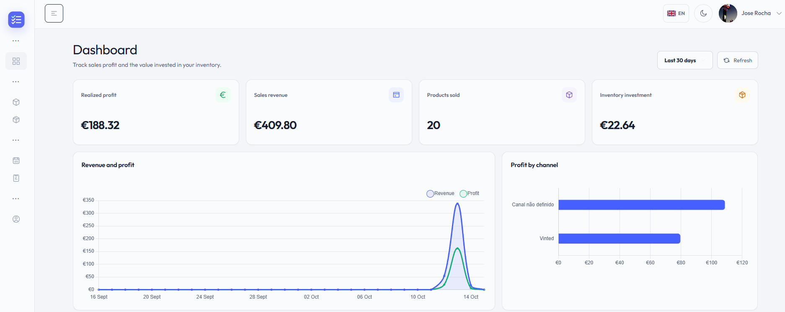
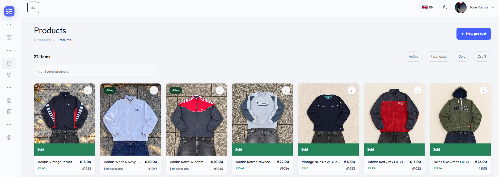
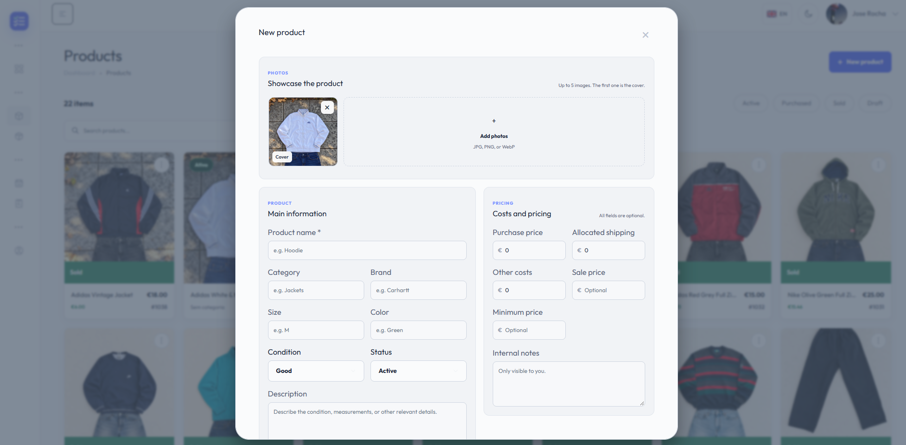
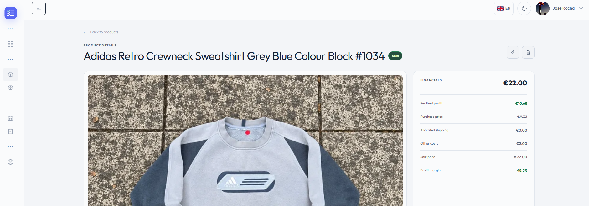
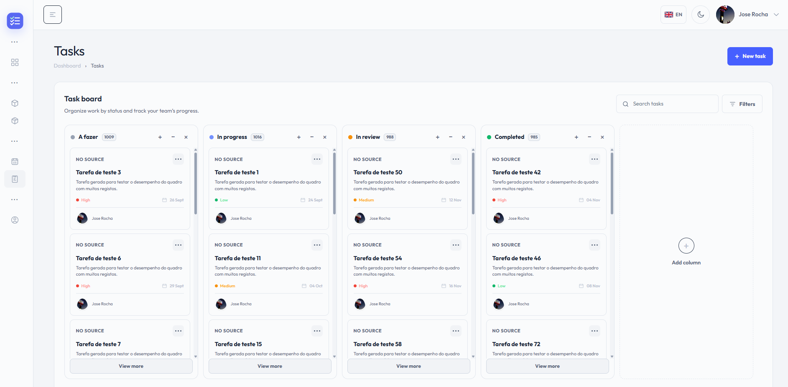

# WorkTracker

WorkTracker is a full-stack inventory and sales management app for small resellers and independent sellers. It brings purchasing, stock, sales, sourcing channels, and day-to-day tasks together so the operator can follow each item from acquisition to sale.

## System walkthrough

The screenshots follow the main workflow, from the business overview to product management and task tracking.

### 1. Dashboard

Review realised profit, sales revenue, items sold, inventory investment, and performance by channel.



### 2. Product catalogue

Search and filter the inventory, then scan product photos, statuses, and prices at a glance.



### 3. Add a product

Capture product photos and details alongside purchase costs, allocated shipping, and pricing.



### 4. Product and sale details

Trace a sold item from its sale price back to purchase price and other costs, with realised profit and margin shown together.



### 5. Task board

Organise follow-up work across configurable Kanban statuses.



## The real-world problem it solves

Independent sellers often track purchases, shipping costs, stock, sales, and follow-up work in separate spreadsheets or notes. That makes it harder to answer practical questions such as what each item really cost, which sales are profitable, and what still needs attention.

WorkTracker keeps those steps connected:

- **Keep stock organised:** record products with condition, status, details, and photos, then search and filter the catalogue.
- **Understand the true cost of a purchase:** group products under purchase orders and allocate shipping and other costs to stock.
- **Measure sales performance:** record sale price, date, costs, and sourcing channel; review realised profit, revenue, and stock potential on the dashboard.
- **Track work around the operation:** manage sourcing channels and move tasks through configurable Kanban statuses.
- **Keep each account's workspace separate:** authenticated operations are scoped to the current user.

### Typical workflow

1. Add the places or channels where items are sourced and sold.
2. Register a purchase order with its products, shipping, and other shared costs.
3. Update each product's details, photos, condition, and listing price as it enters stock.
4. Record the sale and its costs when an item sells.
5. Review realised profit and remaining stock potential on the dashboard; use the task board to track follow-up work.

### CV-ready project summary

> Built WorkTracker, a full-stack inventory and sales management platform for independent resellers, connecting purchase orders, product stock, image uploads, sales, and task workflows with per-user data isolation and a profitability dashboard.

## Main features

- Product catalogue with image uploads, search, filters, pagination, and product details.
- Purchase orders with multiple products, shipping and other costs, and order status tracking.
- Sales recording with sale date, selling channel, and additional costs.
- Dashboard with revenue, realised profit, sold items, invested stock, recent sales, and estimated stock potential.
- Sourcing channels with their own details and images.
- Kanban task board with configurable statuses and drag-and-drop organisation.
- Account registration, sign-in, Google sign-in, and profile management.

## Technology

- **Frontend:** Angular 22, TypeScript, and SCSS.
- **Backend:** ASP.NET Core and .NET 10.
- **Data:** SQL Server with Entity Framework Core migrations.
- **Authentication:** JWT-based authentication and Google Identity Services.

## Run locally

### Prerequisites

- .NET 10 SDK.
- Node.js and npm versions compatible with Angular 22.
- SQL Server. The included Windows development configuration uses SQL Server LocalDB.

### 1. Configure the API

From the repository root, set a database connection string and a unique JWT secret in the process environment. The secret should be random and at least 32 characters long. Do not use the example secret in `appsettings.Development.json` in a shared or public environment.

PowerShell:

```powershell
$env:ConnectionStrings__DefaultConnection = "Server=(localdb)\MSSQLLocalDB;Database=WorkTrackerDb;Trusted_Connection=True;TrustServerCertificate=True"
$env:Jwt__Secret = "replace-with-a-random-secret-at-least-32-characters-long"
```

Install the EF Core tool once if it is not already installed:

```powershell
dotnet tool install --global dotnet-ef --version 10.0.11
```

Apply the database migrations and start the API:

```powershell
dotnet ef database update --project backend/WorkeTracker/Infrastructure --startup-project backend/WorkeTracker/WorkeTracker
dotnet run --project backend/WorkeTracker/WorkeTracker --launch-profile https
```

The API uses the HTTPS profile in `launchSettings.json` and is available at `https://localhost:7176`. If needed, trust the local development certificate with `dotnet dev-certs https --trust`.

### 2. Start the frontend

In a separate terminal:

```powershell
cd frontend
npm ci
npm start
```

Open `http://localhost:4200`. The development server forwards `/api` requests to `https://localhost:7176`, as configured in `frontend/proxy.conf.json`.

### 3. Configure Google sign-in (optional)

Create a **Web application** OAuth client in Google Cloud Console and add `http://localhost:4200` as an authorised JavaScript origin. The app uses Google Identity Services to send an ID token to the API, so this flow does not require an OAuth client secret or an authorised redirect URI.

Set the same OAuth client ID in both places:

- Frontend: `frontend/src/environments/environment.development.ts` (`googleClientId`). A client ID is public and can be included in frontend code; never put a client secret there.
- Backend: set `Google__ClientId` in the API process environment. ASP.NET Core maps this to the `Google:ClientId` setting and uses it to validate the ID token audience.

PowerShell:

```powershell
$env:Google__ClientId = "your-client-id.apps.googleusercontent.com"
```

For production, set the same client ID in the frontend's production environment and the backend environment. Add the deployed frontend origin to the OAuth client's authorised JavaScript origins.

## Configuration and uploaded files

For other environments, set `ConnectionStrings__DefaultConnection`, `Jwt__Secret`, `Cors__AllowedOrigins`, and `Google__ClientId` through environment variables or a platform secret manager. `Cors__AllowedOrigins` must contain the frontend's exact origin, including the protocol. Do not commit secrets to the repository.

Database migrations are in `backend/WorkeTracker/Infrastructure/Migrations`. Uploaded images are stored locally in `backend/WorkeTracker/WorkeTracker/wwwroot/uploads`; deployments with ephemeral storage or multiple instances should use shared persistent storage.

## Repository map

```text
backend/WorkeTracker/
  WorkeTracker/       ASP.NET Core API, controllers, middleware, and authentication
  Application/        Use cases, application services, and DTOs
  Domain/             Entities, enums, business rules, and interfaces
  Infrastructure/     EF Core persistence, repositories, queries, uploads, and migrations
  Application.Tests/  Unit tests for application services
database/             SQL schema and DBML model
docs/images/
  screenshots/        Numbered application screenshots used in this walkthrough
frontend/
  public/              Static assets served by Angular
  src/app/core/        Authentication, layout, theme, and shared application services
  src/app/features/    Dashboard, products, orders, sources, tasks, profile, and auth screens
  src/app/shared/      Reusable UI, utilities, and security helpers
```

The backend is organised into Domain, Application, Infrastructure, and API projects. The frontend groups screens by product feature, with shared layout and UI code kept under `core` and `shared`.

## License

This project has no license. Publishing the repository does not grant permission to reuse, modify, or redistribute the code.
